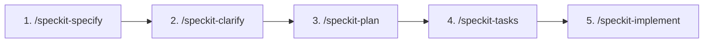

# Guía de Spec-Driven Development (SDD) con Spec-Kit

Esta guía describe de forma simple el flujo de trabajo y el propósito de cada comando al desarrollar funcionalidades, mejoras o correcciones en cualquier proyecto de software utilizando el enfoque de **Desarrollo Guiado por Especificaciones (SDD)**.

---

## 🔄 El Flujo General

El ciclo de desarrollo sigue 5 pasos secuenciales obligatorios. **No se escribe código fuente hasta llegar al último paso.**



---

## 🛠️ Comandos y Artefactos

### 1. `/speckit-specify`
* **¿Qué hace?**: Es el punto de partida. Toma una idea, un requerimiento en lenguaje natural o un archivo existente de documentación (por ejemplo, un archivo `.md`) y genera la especificación formal del requerimiento (*Feature Specification*).
* **¿Escribe código?**: ❌ **No.**
* **Artefacto generado**: `specs/<numero>-<feature>/spec.md`
* **Contenido**:
  * Historias de usuario (*User Stories*).
  * Criterios de aceptación funcionales y no funcionales (formato Gherkin: *Dado que / Cuando / Entonces*).
  * Casos borde, reglas de validación y restricciones del negocio.
* **Ejemplos de uso en el chat**:
  ```text
  /speckit-specify Crear endpoint para autenticación de usuarios con correo y contraseña
  ```
  ```text
  /speckit-specify Basado en docs/requerimientos/registro_lotes.md genera la especificación
  ```

---

### 2. `/speckit-clarify`
* **¿Qué hace?**: Analiza el archivo `spec.md` en busca de vacíos, ambigüedades o aspectos no especificados, y realiza preguntas puntuales para resolverlos y acotar el alcance.
* **¿Escribe código?**: ❌ **No.**
* **Artefacto generado**: Actualiza directamente `spec.md` incorporando las respuestas, aclaraciones y decisiones tomadas.
* **Ejemplo de uso en el chat**:
  ```text
  /speckit-clarify
  ```

---

### 3. `/speckit-plan`
* **¿Qué hace?**: Diseña la **solución técnica y arquitectónica** para cumplir con la especificación. Revisa la constitución/estándares del proyecto (`constitution.md`), define qué capas intervenir, qué contratos o esquemas actualizar y qué patrones de diseño aplicar según el stack tecnológico en uso.
* **¿Escribe código?**: ❌ **No.**
* **Artefacto generado**: `specs/<numero>-<feature>/plan.md`
* **Contenido**:
  * Decisiones técnicas y dependencias requeridas.
  * Componentes, archivos, modelos y contratos a crear o modificar.
  * Cambios en base de datos, migraciones o contratos de API requeridos.
* **Ejemplo de uso en el chat**:
  ```text
  /speckit-plan
  ```

---

### 4. `/speckit-tasks`
* **¿Qué hace?**: Desglosa el plan técnico (`plan.md`) en una lista ordenada de tareas atómicas, claras y ejecutables paso a paso.
* **¿Escribe código?**: ❌ **No.**
* **Artefacto generado**: `specs/<numero>-<feature>/tasks.md`
* **Contenido**:
  * Checklists organizadas con orden de dependencias lógicas (por ejemplo: primero esquemas/modelos, luego capa de lógica/servicios, luego interfaces/controladores y finalmente tests).
* **Ejemplo de uso en el chat**:
  ```text
  /speckit-tasks
  ```

---

### 5. `/speckit-implement`
* **¿Qué hace?**: **Fase de construcción de código.** Toma la lista de tareas de `tasks.md` y construye la solución de forma guiada, componente por componente, respetando las especificaciones y estándares establecidos.
* **¿Escribe código?**: ✅ **SÍ.**
* **Resultado**:
  * Código fuente creado o modificado en el lenguaje o framework del proyecto.
  * Pruebas unitarias y de integración correspondientes.
  * Ejecución de la suite de pruebas del proyecto para asegurar que todo compile y pase exitosamente.
  * Actualización del estado de las tareas completadas en `tasks.md`.
* **Ejemplo de uso en el chat**:
  ```text
  /speckit-implement
  ```

---

## 📌 Resumen Rápido

| Fase | Comando | Entrada | Salida | ¿Toca Código? |
| :--- | :--- | :--- | :--- | :---: |
| **1. Definir QUÉ** | `/speckit-specify` | Requerimiento / Documento | `spec.md` | ❌ No |
| **2. Pulir dudas** | `/speckit-clarify` | `spec.md` | `spec.md` actualizado | ❌ No |
| **3. Diseñar CÓMO** | `/speckit-plan` | `spec.md` + estándares (`constitution.md`) | `plan.md` | ❌ No |
| **4. Dividir trabajo** | `/speckit-tasks` | `plan.md` | `tasks.md` | ❌ No |
| **5. Construir** | `/speckit-implement` | `tasks.md` | Código fuente + Tests | ✅ **SÍ** |

---

## 🧭 Comandos Adicionales y Herramientas de Soporte

Además del flujo secuencial principal de 5 pasos, existen comandos complementarios para tareas de gobernanza, calidad y apoyo en el desarrollo:

### 🧩 Comandos Complementarios de Spec-Kit

* **`/speckit-constitution` (Constitución y Estándares Técnicos)**:
  * **Propósito**: Crea o actualiza el archivo `constitution.md` del repositorio. Define las reglas no negociables del proyecto: estándares de arquitectura, estilo de código, librerías autorizadas y patrones que `/speckit-plan` e `/speckit-implement` deben obedecer.
  * **Cuándo usarlo**: Al inicio de un proyecto o cuando el equipo actualiza sus directrices de diseño.

* **`/speckit-analyze` (Auditoría de Calidad y Consistencia)**:
  * **Propósito**: Ejecuta un análisis estático no destructivo cruzando `spec.md`, `plan.md` y `tasks.md` para detectar inconsistencias, requerimientos huérfanos o dependencias rotas antes de comenzar a codificar.
  * **Cuándo usarlo**: Después de `/speckit-tasks` y antes de `/speckit-implement`.

* **`/speckit-checklist` (Listas de Verificación Personalizadas)**:
  * **Propósito**: Genera checklists a medida según los requerimientos del feature (ej. checklist de seguridad, validación de migraciones, performance o criterios de despliegue).
  * **Cuándo usarlo**: Para auditorías previas al pase a producción o revisiones cruzadas.

* **`/speckit-converge` (Alineación de Código vs. Especificación)**:
  * **Propósito**: Compara el estado real del código fuente contra `spec.md`, `plan.md` y `tasks.md`. Si detecta tareas pendientes o discrepancias entre lo planeado y lo construido, añade automáticamente las tareas faltantes a `tasks.md`.
  * **Cuándo usarlo**: Al retomar un feature a medias o al final de la implementación para validar que no queden cabos sueltos.

* **`/speckit-taskstoissues` (Conversión a GitHub Issues)**:
  * **Propósito**: Transforma las tareas ordenadas de `tasks.md` en tickets/issues de GitHub con sus respectivas dependencias y etiquetas.
  * **Cuándo usarlo**: Cuando el equipo gestiona el trabajo mediante tableros de GitHub Projects o Issues.

---

### ⚡ Comandos de Asistencia en el Entorno

Herramientas para interactuar con el asistente y optimizar el proceso de desarrollo:

| Comando | Propósito |
| :--- | :--- |
| **`/grill-me`** | Inicia una entrevista técnica interactiva donde el asistente cuestiona decisiones, trade-offs y casos borde antes de redactar especificaciones o planes. |
| **`/goal`** | Modo de ejecución autónoma exhaustiva para tareas de largo aliento; el agente no se detiene hasta verificar que el objetivo esté completamente alcanzado. |
| **`/learn`** | Registra convenciones, atajos o configuraciones aprendidas durante la conversación para que persistan en futuras sesiones. |
| **`/schedule`** | Configura recordatorios puntuales o tareas recurrentes en segundo plano. |
| **`/browser`** | Activa la navegación e inspección visual en páginas o aplicaciones web. |

